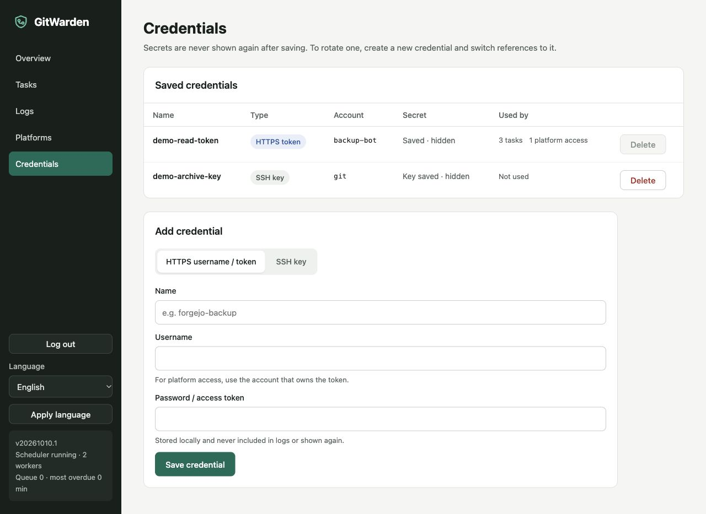
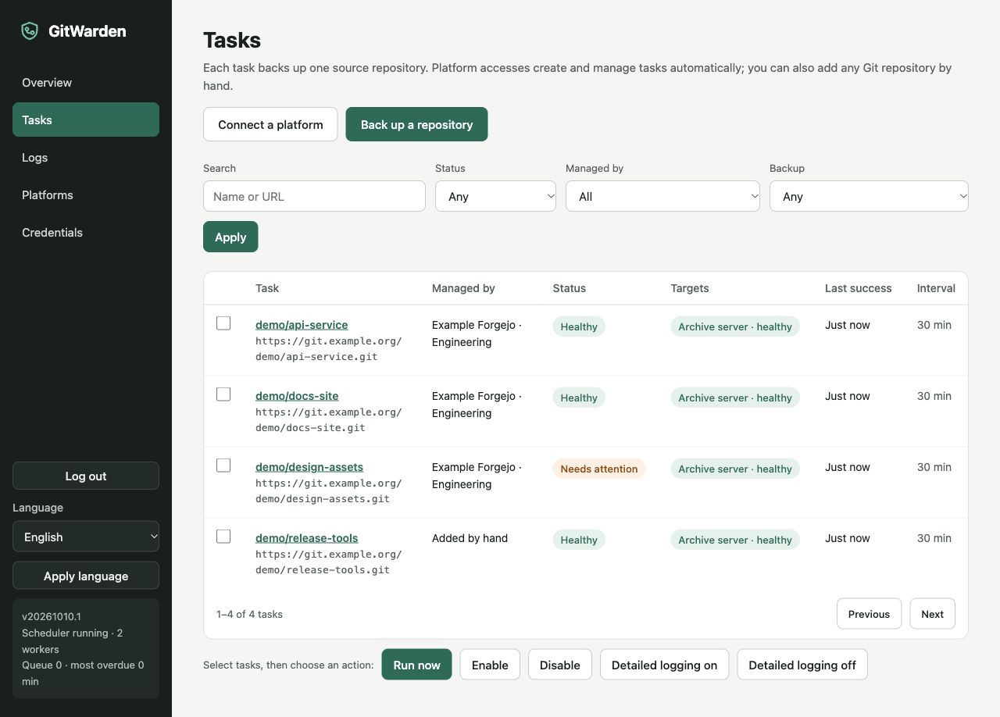
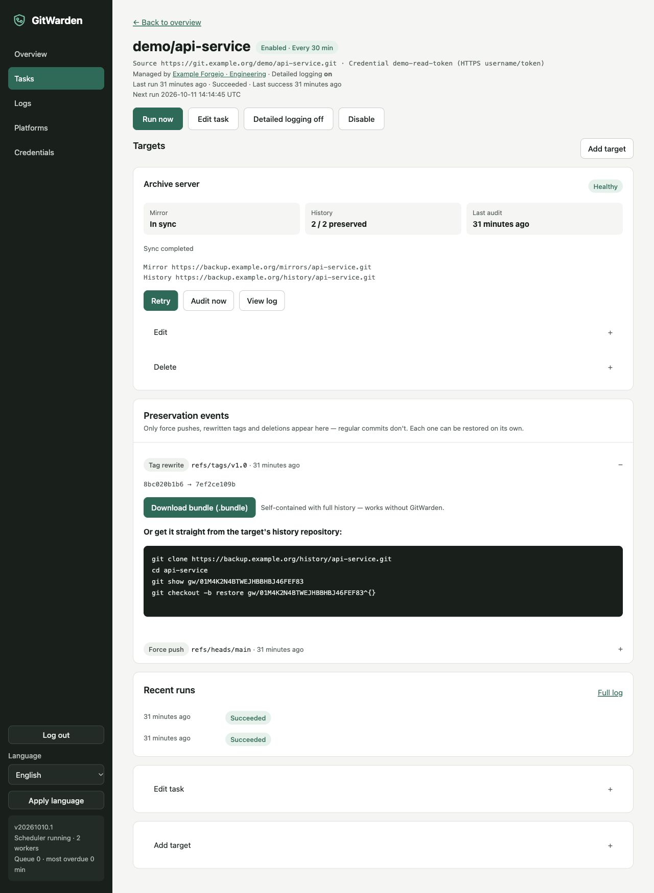

# Getting started

This guide takes a fresh deployment from its first login to a verified backup task. Deploy the service first with [Deployment](Deployment.md), then keep the application volume and the two target repositories private.

## Before you begin

You need:

- a reachable source Git URL and credentials with read access when it is private;
- two empty target repositories for each manual target: one main mirror and one history repository;
- write access for GitWarden to both targets, with no other writer, CI job, or webhook consuming backup pushes;
- an administrator password in the container environment.

The core workflow accepts anonymous, HTTPS, SSH, SCP-style SSH, and local absolute-path Git endpoints. HTTP(S) URLs must not contain a username or password; SSH URLs may include the SSH account name. Use **Credentials** to keep secrets out of URLs, command arguments, and logs.

## Save credentials

Open **Credentials** in the sidebar.

- Choose **HTTPS** for a username/password or token. The username is sent to the remote's Git authentication flow; the secret is not shown again.
- Choose **SSH** for a private key and paste the exact host key line(s) required by `known_hosts`. Host-key verification is strict, so an unknown or changed host key stops the run.
- Leave the credential unselected only when the endpoint is intentionally anonymous.

Use **Edit credential** to rotate a token or SSH key in place. Leave the password/token or private key blank to keep its current value; the type stays fixed. All referring tasks, targets, and platform accesses use the new value on their next run, and target bindings are retained.

Credentials cannot be deleted while a task, target, or platform access references them. The UI never places private keys or token values in its display context.





## Create a manual task

1. Select **Back up a repository** from the overview or task list.
2. In **Source**, enter a task name, a Git URL, the source credential if needed, and the sync interval in minutes. A hand-created task defaults to 60 minutes; the configured minimum is five minutes by default.
3. In **Targets**, select **Enter two URLs** and enter two different URLs. For example:

   ```text
   source   https://example.org/invalid/source.git
   main     https://example.org/invalid/main.git
   history  https://example.org/invalid/history.git
   ```

   The main and history repositories must already exist and be empty. Select the credential that can write both repositories, or leave it empty for anonymous write access.
4. In **Review**, confirm that GitWarden is the only writer, both target repositories are private, and their pushes do not trigger CI or webhooks. Create the task.
5. Creation binds the target and queues the first run automatically. Check it on the task detail page; use **Run now** for a later manual run. The first run is marked as an initial backup and may take a long time for a large repository; progress is shown while Git reports progress.



The task detail page has one card per target. A healthy card reports the main mirror in sync, the count of preservation records confirmed in the history repository, and the last audit time. Use **Retry** for a target-only retry, **Audit** to compare the history repository with the local confirmation records, and **Logs** to inspect each run step and ref change.

## Add more targets

After a task is created, use **Add target** on its detail page to attach another main/history pair. Each target has its own credentials, binding state, push records, conflicts, and audit result. One target can be offline while other targets continue; the run is shown as partial when at least one target succeeds and another fails.

## Use a platform access

For Gitea or Forgejo, configure an instance and access first, then choose **Create on a platform** in the target step. Provisioning creates a private `<name>` repository and a private `<name>-history` repository, disables repository features such as Actions, protects `gw/*` on the history repository, and binds the new pair. Read [Platforms](Platforms.md) before granting the token.

GitHub has no platform adapter. Configure its source and both targets through the manual path above.

## What to check after the first run

- `/health` returns the expected version and, when supplied at build time, the build Git commit.
- The task has a successful run and each target is bound and healthy.
- The history count is `0` for an initial run with no rewritten or deleted refs; it increases only when an already collected object is replaced or removed.
- The **Logs** page shows `capture`, target history, gate, mirror, and audit steps without exposing credentials.
- If `.gitattributes` declares LFS or the repository contains `.gitmodules`, the task displays an incomplete-backup warning. The Git objects are present, but external LFS payloads and submodule repositories are not copied.
