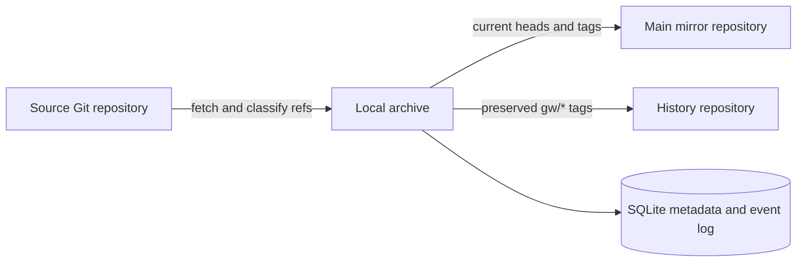

# GitWarden wiki

> Mirror the present. Preserve the past.

This directory contains the Markdown source for the GitHub Wiki. The project README is the short entry point; these pages carry the operational details needed to deploy, configure, operate, and recover a GitWarden instance.

## Choose a task

| If you need to… | Read |
| --- | --- |
| Start a first local backup | [Getting started](Getting-started.md) |
| Run Compose or plain Docker | [Deployment](Deployment.md) |
| Set environment variables and TOML | [Configuration](Configuration.md) |
| Back up the GitWarden volume or recover a preserved version | [Backup and recovery](Backup-and-recovery.md) |
| Configure Gitea or Forgejo discovery and provisioning | [Platforms](Platforms.md) |
| Interpret a failed run or target status | [Troubleshooting](Troubleshooting.md) |

## The data path

The archive is the durable source of truth for collected Git objects. SQLite indexes tasks, targets, runs, and preservation events. The main mirror follows the current collected refs. The history repository receives only the preservation tags needed to keep older objects reachable outside the application host.

## Safety boundary

GitWarden preserves a branch or tag only after a polling run has collected it. A change between runs is outside the guarantee. When a collected branch is force-pushed or deleted, or a collected tag is rewritten, the old object is preserved locally first, then pushed to the history repository, and only then can the main mirror be changed. The history repository must have GitWarden as its only writer; a third-party rewrite or deletion is reported by audit and cannot be silently repaired.

Git objects are covered. LFS payloads and submodule repositories are detected and reported as an incomplete backup; their external content is not fetched. The history repository does not contain every current branch and tag, so keep the main mirror and the application data volume for complete current-state recovery.

## Screenshots

Screenshots referenced by these pages live under `docs/images/` in the repository. They are illustrative UI captures; commands and status meanings in the text are authoritative.

- [Getting started](Getting-started.md) — task list and task detail
- [Platforms](Platforms.md) — instance and access settings
- [Backup and recovery](Backup-and-recovery.md) — backup wizard
- [Troubleshooting](Troubleshooting.md) — run and activity logs

Return to the [project README](../../README.md) or the [Chinese README](../../README.zh-CN.md).
