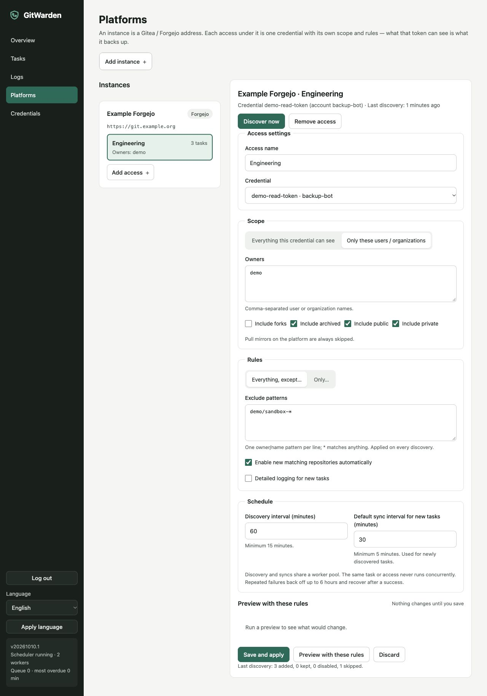

# Platforms

The platform adapter is deliberately small. It currently supports Gitea and Forgejo for repository discovery and target provisioning. The core mirror workflow remains platform-neutral and works with GitHub or any other supported Git URL when configured manually.

## Create a platform access

1. Open **Credentials** and create an HTTPS credential with the platform account name and API token. Do not paste the token into the instance URL.
2. Open **Platforms**, add an instance, choose **Gitea** or **Forgejo**, and enter its base HTTP(S) URL without query, fragment, username, or password.
3. Add an access under that instance and select the HTTPS credential.
4. Choose the discovery scope, visibility filters, include/exclude patterns, auto-enable behavior, detailed-log default, and discovery/sync intervals.
5. Use **Preview** to see Add, Keep, Disable, Skip, and Other access results without writing tasks. **Save and apply** stores the settings and queues a complete discovery.

A new access is scheduled immediately using its initial defaults. Turn off automatic enabling when adding the access if you want to review and narrow its scope before new tasks run.

The client reads all pages before applying a discovery result. If a page or total count cannot be verified, the round fails without a partial task update.

## Token permissions

For a full discovery and provisioning access, grant the account a token with the scopes used by the selected operations:

| Scope | Used for |
| --- | --- |
| `read:admin` | Instance-wide repository enumeration and administrator-level hook visibility. |
| `write:repository` | Creating and hardening repositories, reading repository metadata, and protecting history tags. |
| `write:organization` | Provisioning inside an organization and reading organization-owned repositories when required by the instance. |
| `write:user` | Reading the authenticated account and provisioning personal repositories. |

The configured access must contain a username and a non-empty token. A token with less visibility can be used for an owners-scoped access when the platform permits those API calls, but it cannot be assumed to discover every private repository or provision every target. Keep the token account limited to the platform and repositories it is intended to manage.

## Discovery scope and rules

An access can enumerate all repositories visible to its token or only the repositories belonging to one or more users or organizations. It can additionally include or exclude forks, archived repositories, and public or private repositories. Pull mirrors are always skipped.

Rules use `owner/name` matching. In exclude mode, matching names are left out; in include mode, only matching names are selected. For example, `sample/*` selects one organization and `*/tmp-*` matches temporary repositories. One pattern per line or comma-separated patterns are accepted.

Newly selected repositories create enabled tasks when **Auto-enable new tasks** is on. A task excluded by a later rule is disabled and marked excluded; if the rule matches again, its enabled state follows the access's auto-enable setting. A repository missing from a complete discovery is marked not visible and is not deleted. If a later source fetch confirms that it no longer exists, the task can become source-gone. In both cases the local archive and target history remain.

Repositories are identified by their platform repository ID. A rename updates the task's source URL without creating a second archive. When two accesses see the same repository, the first managing access keeps ownership and the other result is reported as Other access. Removing an access converts its tasks to manual management and keeps their archive and history.

## Provision a target pair

From the target step of the backup wizard, select **Create on a platform**, an access, an owner, and a target name. Provisioning creates two repositories named `<name>` and `<name>-history`. It then:

- makes both repositories private;
- disables Actions, wiki, issues, pull requests, packages, releases, and projects where the platform exposes those switches;
- confirms that both repositories are not platform mirrors;
- protects `gw/*` on the history repository for the GitWarden account;
- reads repository, organization, and available system webhook metadata for administrator review;
- binds both empty repositories to the task.

If either repository already exists, provisioning refuses to adopt or modify it. If a later provisioning step fails after one repository was created, the page reports the repositories left behind; handle those repositories manually before retrying. The adapter does not delete remote repositories as cleanup.

Webhook inspection is a review aid, not a guarantee that no webhook exists. Organization-level and system/default hooks can be outside repository settings, and Forgejo versions may not list every default hook through the API. Check the platform administration UI and keep backup repositories out of automation paths that react to pushes. GitWarden stores only hook ID, type, and enabled state in the target notice; it does not store hook configuration secrets.

## GitHub and other Git hosts

There is no GitHub discovery or provisioning adapter. To use GitHub, add the source and the two target URLs manually, select credentials for each endpoint, and create the target repositories as private empty repositories before binding. The same applies to any other host that speaks a supported Git protocol.
